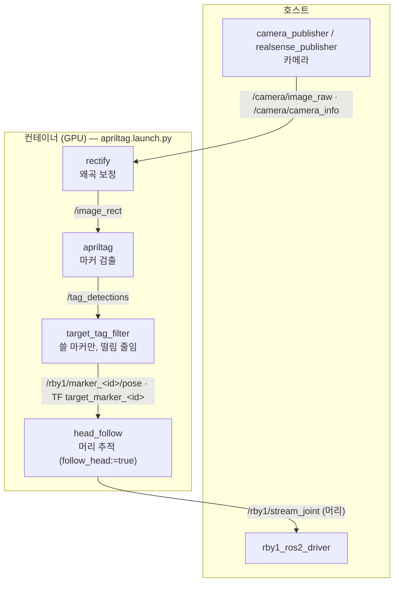

# RB-Y1 AprilTag 사용 가이드

카메라 영상에서 AprilTag 마커를 GPU로 찾아, 마커의 자세를 토픽과 TF로 내보냅니다. 카메라는 호스트에서 켜고 영상만 컨테이너로
넘깁니다.

> ⚠️ 시뮬레이터와 마커 그림 파일로 확인한 절차입니다. 실제 마커·로봇으로는 아직 돌려 보지 않았습니다.

---

## 1. 노드 구성



---

## 2. 준비

| 항목 | 값 |
|---|---|
| 환경, 이미지, 빌드 | [tutorial_cumotion.md 2. 준비](tutorial_cumotion.md#2-준비)와 같음 |
| 카메라 | USB 웹캠, 또는 RealSense(호스트에 `sudo apt install ros-humble-librealsense2` 뒤 드라이버 워크스페이스 빌드) |
| 마커 | `tag36h11` 패밀리 인쇄물([이미지](https://github.com/AprilRobotics/apriltag-imgs/tree/master/tag36h11)). 검은 사각형 한 변 길이를 재 둡니다 |

**먼저 마커 크기를 맞춥니다.** `rby1_apriltag/config/target_tags.yaml`:

```yaml
apriltag:
  ros__parameters:
    size: 0.08            # 인쇄한 마커의 검은 사각형 한 변 (m). 틀리면 거리가 그만큼 틀립니다
target_tag_filter:
  ros__parameters:
    target_ids: [7,8]     # 쓸 마커 번호
```

---

## 3. 켜기

```bash
# 터미널 1 — 호스트: 카메라
ros2 launch rby1_additional_tools camera.launch.py camera:=realsense      # RealSense
ros2 launch rby1_additional_tools camera.launch.py                        # 웹캠 (/dev/video0)

# 터미널 2 — 컨테이너: 마커 검출
isaac-ros
ros2 launch rby1_apriltag apriltag.launch.py
```

아래가 나오면 됩니다.

```
markers: tag36h11, black square 0.08 m, target ids [7, 8] (settings: …/rby1_apriltag/config/target_tags.yaml)
```

- 화면으로 보려면 카메라 런치에 `rviz:=true`를 붙입니다. 마커를 찾으면 영상의 마커 위에 좌표축이 얹힙니다.
- 카메라 해상도가 1280×720이 아니면 검출 런치에 `width:=… height:=…`를 줍니다.
- RealSense를 웹캠 모드로 켜면 `cannot open /dev/video0 as a webcam`으로 끝납니다. `camera:=realsense`를 붙입니다.
- 카메라를 바꿨으면 검출 런치도 다시 켭니다.

---

## 4. 예제

| 예제 | 목표 |
|---|---|
| [4.1 마커 좌표 보기](#41-마커-좌표-보기) | 마커가 어디 있는지 확인 |
| [4.2 머리가 마커를 따라감](#42-머리가-마커를-따라감) | 마커를 화면 가운데 근처에 둠 |
| [4.3 손이 마커를 따라감, 마커를 장애물로](#43-손이-마커를-따라감-마커를-장애물로) | 마커가 있는 곳으로 손이 가거나, 그 자리를 피해서 감 (cuMotion과 같이) |

### 4.1. 마커 좌표 보기

```bash
ros2 topic echo /rby1/marker_7/pose --once            # 카메라 기준. position.z = 카메라에서 거리 (m)
ros2 run tf2_ros tf2_echo base target_marker_7        # 로봇 기준 (드라이버와 cuMotion 런치가 떠 있을 때)
```

### 4.2. 머리가 마커를 따라감

드라이버가 떠 있어야 합니다. 3장의 검출 런치를 끄고 아래로 다시 켭니다. **로봇의 머리가 움직입니다.**

```bash
ros2 launch rby1_driver rby1_ros2_driver.launch.py                    # 호스트
ros2 launch rby1_apriltag apriltag.launch.py follow_head:=true        # 컨테이너
```

- 마커가 화면 가운데에서 벗어나면 머리가 따라 돌고, 가운데 근처로 들어오면 멈춥니다.
- 마커를 0.5초 놓치면 멈추고, 3초 놓치면 정면으로 돌아갑니다.
- 따라갈 마커는 `target_tags.yaml`의 `head_follow: marker_id`(기본 7)입니다.
- 머리가 가운데를 지나쳤다 돌아오면 `head_follow: speed`를 낮춥니다.

### 4.3. 손이 마커를 따라감, 마커를 장애물로

cuMotion과 같이 켜야 합니다. 예제 런치 하나로 켜는 방법은 [tutorial_cumotion.md 3.1](tutorial_cumotion.md#31-카메라의-마커를-쓸-때),
손이 마커 하나를 따라가거나 여러 마커를 번호 순서로 도는 것은 [4.2](tutorial_cumotion.md#42-목표를-계속-보내기), 마커 자리를 장애물로 피하는 것은
[4.3](tutorial_cumotion.md#43-장애물)에 있습니다.

---

## 5. 내 프로그램에서 마커 쓰기

| 이름 | 타입 | 내용 |
|---|---|---|
| `/rby1/marker_<id>/pose` | `geometry_msgs/PoseStamped` | 마커 번호별 자세. `camera_optical_frame` 기준 (z 앞, x 오른쪽, y 아래) |
| `/rby1/marker/pose` | `geometry_msgs/PoseStamped` | 쓰는 마커 전부가 한 토픽에 |
| TF `target_marker_<id>` | | 로봇 TF가 있으면 `base → target_marker_<id>`로 조회 |
| `/camera/image_raw`, `/camera/camera_info` | `sensor_msgs/Image`, `CameraInfo` | 카메라 영상과 카메라 모델 |

---

## 6. 설정

`rby1_apriltag/config/target_tags.yaml`을 고치고 런치를 다시 켭니다(다시 빌드하지 않습니다). 한 번만 바꾸려면 런치 인자
`size:=0.08 ids:=7,8`.

| 구역 | 설정 | 기본값 | 뜻 |
|---|---|---|---|
| `apriltag` | `size` | `0.08` m | 마커 검은 사각형 한 변. 쓰는 마커 모두 같은 크기 |
| `target_tag_filter` | `target_ids` | `[7, 8]` | 쓸 마커 번호 |
| | `window_size` | `5` | 최근 몇 장으로 떨림을 줄일지. 좌표가 흔들리면 올립니다 |
| `head_follow` | `enabled` | `false` | `true`면 인자 없이도 머리 추적을 켬 |
| | `marker_id` | `7` | 머리가 따라갈 마커 |
| | `safe_zone`, `start_zone` | `0.03`, `0.10` rad | 이 각 안이면 멈춤 / 이 각을 넘으면 따라감 |
| | `speed` | `0.5` rad/s | 따라가는 속도 |
| | `camera_rpy` | `[0, 0, 0]` | 카메라를 기울여 달았을 때의 각. `camera_mount.yaml`의 `rpy`와 같은 값 |
| `marker_target` | `right_arm: marker_id`, `left_arm: marker_id` | `7`, `8` | 그 손이 따라갈 마커 |
| | `offset` | `[0, 0, -0.10]` m | 마커에서 손이 갈 곳까지 |
| | `min_move` | `0.01` m | 마커가 이만큼 움직여야 새 목표를 보냄 |
| `marker_shuttle` | `arm` | `right_arm` | 마커들을 차례로 돌 팔 |
| | `period` | `5.0` s | 다음 마커로 가는 간격 |
| | `offset` | `[0, 0, -0.10]` m | 마커에서 손이 갈 곳까지 |
| | `fresh` | `1.0` s | 이 시간 안에 보인 마커만 돕니다 |

카메라 설정(해상도, fps, 노출, 보정 파일, 장착 위치)은 드라이버 저장소의 `rby1_additional_tools/config/`에 있습니다
(`realsense.yaml`, `webcam.yaml`, `camera_mount.yaml`). 설명은 드라이버 저장소 `Dev_page.md`.

---

## 참고

- 문제가 생기면 그 터미널의 메시지가 원인과 할 일을 알려 줍니다. 자세한 것은 [developer_manual.md의 트러블슈팅](developer_manual.md#12-트러블슈팅).
- [developer_manual.md](developer_manual.md#apriltag) — 구조, 동작 원리, 측정값
- [tutorial_cumotion.md](tutorial_cumotion.md) — cuMotion 켜기, 마커로 손 움직이기(4.2), 마커를 장애물로(4.3)
