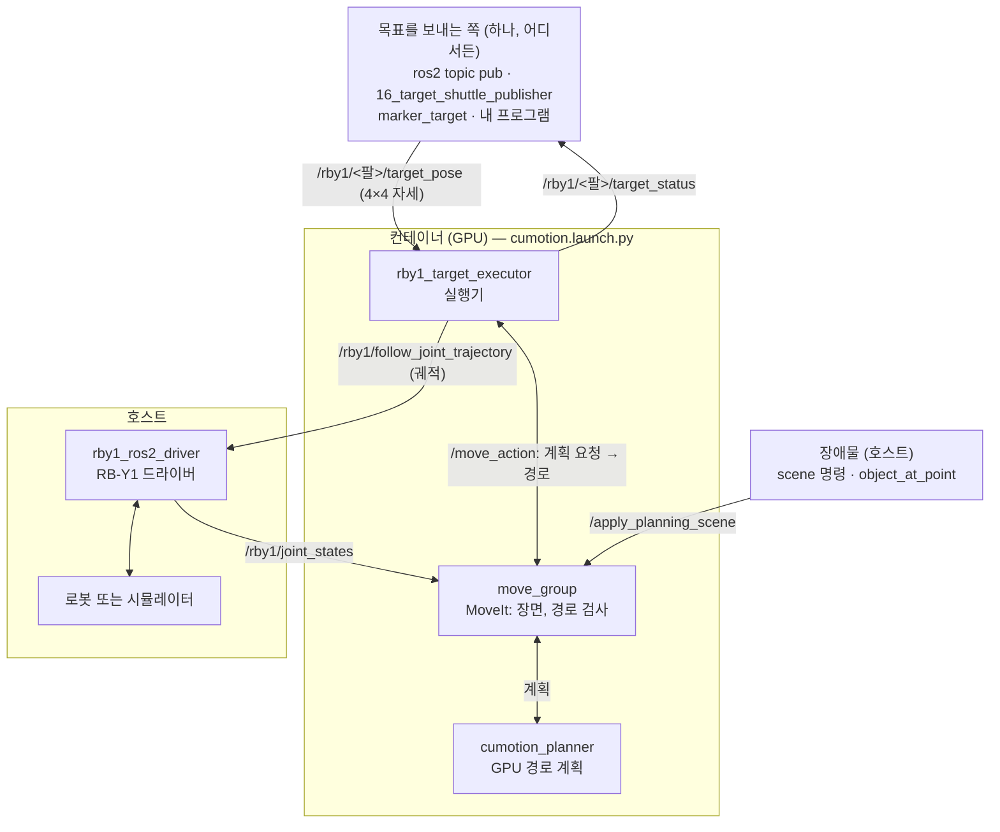
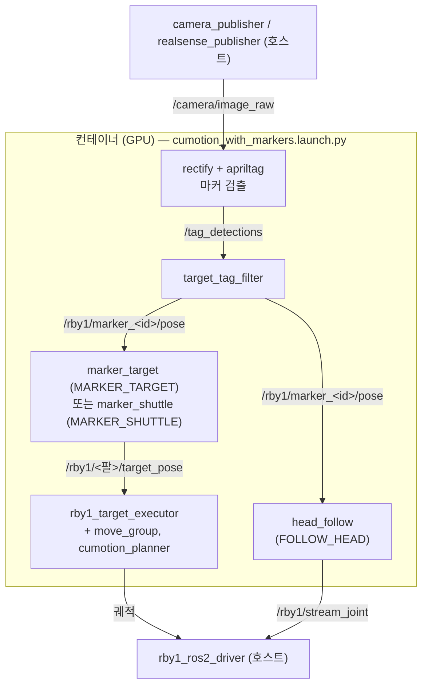
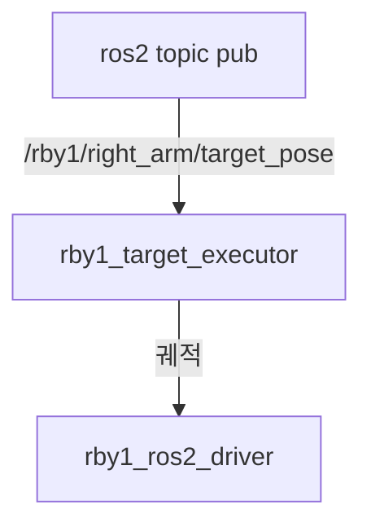
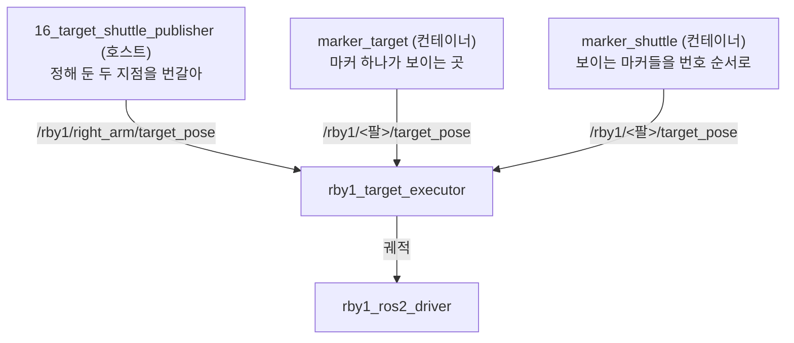
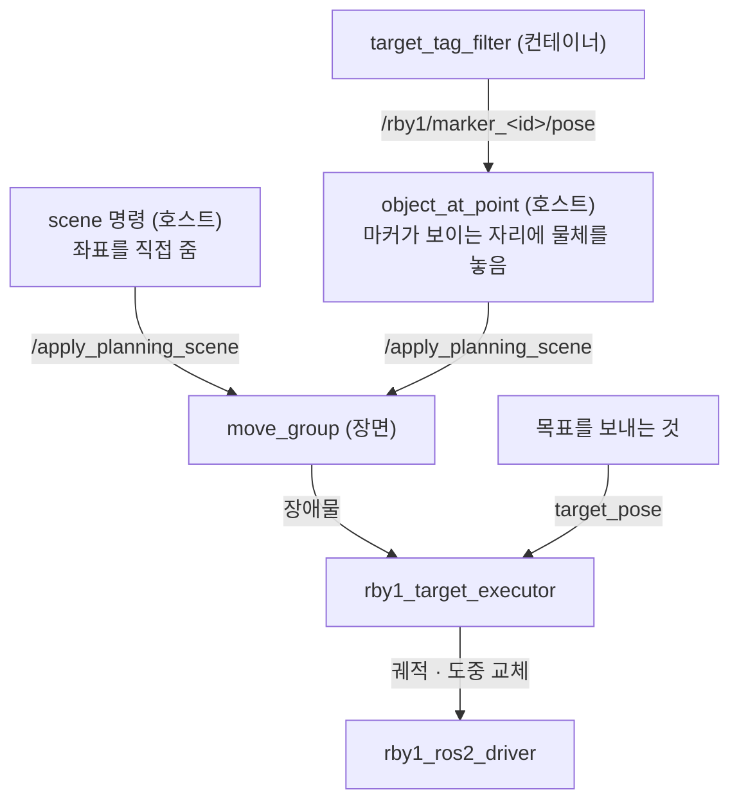
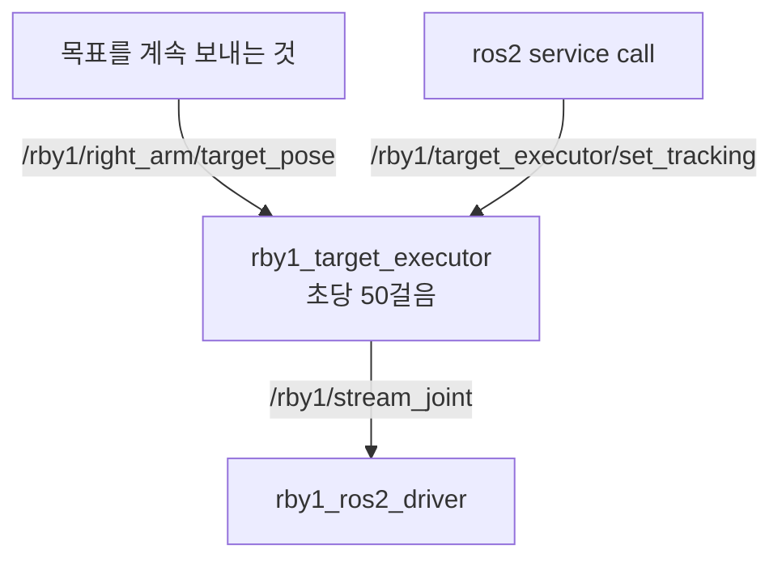
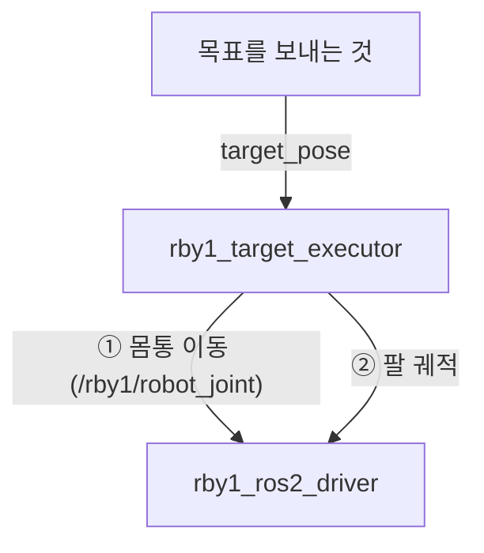

# RB-Y1 cuMotion 사용 가이드

손이 가야 할 자세를 토픽으로 보내면 GPU(cuMotion)가 장애물을 피하는 경로를 계획하고, RB-Y1 드라이버가 로봇을 움직입니다.

> [!NOTE]
> 4.3의 "마커를 장애물로"(왕복 + 마커 장애물 + 머리 추적)는 실제 로봇에서 확인했습니다(2026-10-15). 나머지는 시뮬레이터에서 확인한 절차입니다.

---

## 1. 노드 구성



| 노드 | 하는 일 |
|---|---|
| `rby1_ros2_driver` | 로봇과 통신. 관절 상태를 내고, 궤적을 받아 움직임 |
| `rby1_target_executor` | 목표를 받아 계획을 요청하고, 궤적을 드라이버로 보냄. 움직이는 동안 앞길의 장애물을 살핌 |
| `move_group` | 장애물이 있는 장면을 갖고, 계획을 cuMotion에 넘기고, 나온 경로를 한 번 더 검사 |
| `cumotion_planner` | GPU로 경로를 계획 |

---

## 2. 준비

| 항목 | 값 |
|---|---|
| 환경 | [env_setup_ubuntu_22_04.md](env_setup_ubuntu_22_04.md) (PC), [env_setup_jetson.md](env_setup_jetson.md) (Jetson) — 드라이버, Docker, 이미지, `isaac-ros` 명령 |
| 이미지와 빌드 | 저장소 [README 2장](../README.md#2--컨테이너에서-패키지-빌드) |
| 드라이버 | `~/ros2_driver_ws` 빌드 (드라이버 저장소 README) |

호스트 터미널에서는 먼저 `source ~/ros2_driver_ws/install/setup.bash`를 합니다.

### 2.1. ROS 도메인 (`ROS_DOMAIN_ID`)

같은 네트워크의 다른 로봇·PC와 토픽이 섞이지 않게 하려면 도메인 번호(0~101)를 정합니다. 호스트와 컨테이너가 같은 번호여야
하고, 설정하지 않으면 둘 다 0입니다.

```bash
export ROS_DOMAIN_ID=30                              # 이 터미널에서만 (쓰는 터미널마다 입력)
echo 'export ROS_DOMAIN_ID=30' >> ~/.bashrc          # 항상 (새 터미널부터)
```

- 컨테이너는 만들어질 때의 호스트 값을 받습니다. 번호를 바꿨으면 `docker stop isaac_ros_dev-$(uname -m)-container` 뒤 `isaac-ros`로 다시 만듭니다.
- 확인: `echo $ROS_DOMAIN_ID`. 컨테이너에서 `ros2 node list`에 `/rby1/rby1_ros2_driver`가 보이면 같은 도메인입니다.

---

## 3. 켜기

```bash
# 터미널 1 — 호스트
ros2 launch rby1_driver rby1_ros2_driver.launch.py

# 터미널 2 — 컨테이너
isaac-ros                                         # 컨테이너에 들어갑니다 (꺼져 있으면 켭니다)
ros2 launch rby1_cumotion demo.launch.py          # RViz 포함. 창 없이: cumotion.launch.py
```

> [!CAUTION]
> **런치가 펴져 있는 양팔과 몸통을 준비 자세로 옮깁니다 — 로봇이 움직입니다.** 이 런치가 떠 있는 동안 목표를 받아도 움직입니다.

1분쯤 뒤 `READY`가 나오면 됩니다.

```
[target_executor] waiting for 4x4 targets on /rby1/right_arm/target_pose (group=right_arm, tool=ee_right, frame=base)
[target_executor] READY
```

- 계획하는 팔은 하나입니다(기본 오른팔, [5.1](#51-계획하는-팔-robotgroup)).
- 컨테이너 프롬프트는 `admin@…`이어야 합니다(`root@…`이면 [env_setup 7.2](env_setup_ubuntu_22_04.md#72-isaac-ros-명령-등록)). 컨테이너는 처음 켠 터미널을 닫으면 삭제됩니다.
- 접속할 로봇은 `rby1_driver/config/driver_parameters.yaml`의 `robot_ip`입니다.
- 끌 때는 cuMotion 런치 → 드라이버 순서로 Ctrl+C.

> [!NOTE]
> **시뮬레이터로 해 보려면** 드라이버보다 먼저 켭니다(`robot_ip` 기본값 `127.0.0.1:50051`).
> ```bash
> xhost +local:root
> docker run --rm -it -e DISPLAY=$DISPLAY -v /tmp/.X11-unix:/tmp/.X11-unix \
>     -p 50051:50051 rainbowroboticsofficial/rby1-sim:0.10.6-m_v1.2
> ```

> [!NOTE]
> **영점에서 시작하려면** cuMotion 런치 전에 호스트에서 `ros2 run rby1_examples 06_zero_pose`. 아래 예제의 좌표는 영점에서
> 시작해 런치가 만든 준비 자세 기준입니다.

### 3.1. 카메라의 마커를 쓸 때

마커를 쓰는 예제(4.2의 마커 따라가기, 4.3의 마커를 장애물로)는 카메라와 마커 검출도 켜야 합니다. 위의 cuMotion 런치 **대신**
예제 런치를 켜면 cuMotion과 마커 검출이 같이 켜집니다.



```bash
# 터미널 1, 2 — 호스트
ros2 launch rby1_driver rby1_ros2_driver.launch.py
ros2 launch rby1_additional_tools camera.launch.py camera:=realsense      # 웹캠이면 camera 인자 없이. 화면도 보려면 rviz:=true

# 터미널 3 — 컨테이너
isaac-ros
ros2 launch rby1_isaac_ros_examples cumotion_with_markers.launch.py
```

무엇을 켤지는 런치 파일 맨 위의 값으로 정합니다(`rby1_isaac_ros_examples/launch/cumotion_with_markers.launch.py`).
한 번만 다르게 켜려면 소문자 인자로 줍니다(`marker_target:=true`).

| 값 | 기본 | 뜻 |
|---|---|---|
| `MARKER_TARGET` | `'false'` | `'true'`: 마커를 손 목표로 보냄 (4.2) |
| `MARKER_SHUTTLE` | `'false'` | `'true'`: 보이는 마커들을 번호 순서로 돌며 손 목표로 보냄 (4.2). `MARKER_TARGET`과 같이 켜지 않습니다 |
| `FOLLOW_HEAD` | `''` | `'true'`: 머리가 마커를 따라 돎 |
| `RVIZ` | `'false'` | `'true'`: RViz를 띄움 |
| `IDS` | `''` | 쓸 마커 번호, 예 `'7,8'`. 비우면 `target_tags.yaml`의 값 |

- 기본값 그대로면 마커 좌표만 나오고(`/rby1/marker_<id>/pose`) 로봇은 움직이지 않습니다.
- 마커 크기는 `rby1_apriltag/config/target_tags.yaml`의 `size`를 인쇄한 마커에 맞춥니다. 자세한 것은 [tutorial_apriltag.md](tutorial_apriltag.md).

---

## 4. 예제

`READY`가 나온 상태에서 합니다. 실행기의 답은 `ros2 topic echo /rby1/right_arm/target_status std_msgs/msg/String`으로 봅니다.

| 예제 | 목표 |
|---|---|
| [4.1 목표 하나 보내기](#41-목표-하나-보내기) | 손을 한 자세로 보냄 |
| [4.2 목표를 계속 보내기](#42-목표를-계속-보내기) | 정해 둔 두 지점을 오가거나, 카메라에 보이는 마커가 있는 곳으로 손이 감(하나를 따라가기, 여럿을 차례로 돌기) |
| [4.3 장애물](#43-장애물) | 명령으로 넣은 물체나 마커가 있는 자리를 피해서 감 |
| [4.4 추적 모드](#44-추적-모드) | 계속 움직이는 목표를 끊기지 않고 따라감 |
| [4.5 몸통 쓰기](#45-몸통-쓰기) | 팔이 닿지 않는 목표에 몸통을 같이 씀 |

### 4.1. 목표 하나 보내기



```bash
# 손을 준비 자세에서 30 cm 위로
ros2 topic pub --once /rby1/right_arm/target_pose std_msgs/msg/Float64MultiArray \
    "{data: [0.0012,-0.0001,-1.0,0.413, 0.4792,0.8777,0.0004,-0.367, 0.8777,-0.4792,0.0011,1.416, 0.0,0.0,0.0,1.0]}"
# 준비 자세로 되돌리기 (관절 명령, 장애물을 보지 않음)
ros2 action send_goal /rby1/robot_joint rby1_msgs/action/Rby1JointCommand "{right_arm: {position: [0.0,-0.5,0.0,-1.57,0.0,0.0,0.0], minimum_time: 4.0}}"
```

- 값 16개는 4×4 행렬을 행 순서로 쓴 것입니다. 각 행의 네 번째 값(`0.413`, `-0.367`, `1.416`)이 손의 위치 x, y, z(`base` 기준, m)입니다.
- 모든 값을 소수로 씁니다(`1` 대신 `1.0`).
- 지금 손 자세: `ros2 service call /rby1/get_cartesian_pose rby1_msgs/srv/GetCartesianPose "{ref_link: base, target_link: ee_right}"`
- 움직이는 중에 새 목표를 보내면 멈추지 않고 새 목표로 갑니다.
- `Waiting for at least 1 matching subscription(s)...`가 계속 나오면 실행기가 아직 `READY`가 아닌 것입니다. `READY`가 되면 보내집니다.

### 4.2. 목표를 계속 보내기

목표를 보내는 노드가 다를 뿐, 실행기가 받는 것은 같은 토픽입니다. 셋 중 하나만 켭니다.



**두 지점 왕복**

```bash
ros2 run rby1_examples 16_target_shuttle_publisher          # 호스트. Ctrl+C로 끝
```

- 두 지점과 주기는 파일 맨 위의 `POINT_A`, `POINT_B`, `PERIOD`입니다(`rby1_examples/rby1_examples/16_target_shuttle_publisher.py`).
  지점은 x, y, z(m), roll, pitch, yaw(rad).
- 한 번만 다르게: `--ros-args -p period:=8.0 -p "point_a:=[0.413,-0.367,1.116,-1.571,-1.071,1.571]"`
- `period`는 한 번 움직이는 시간보다 길어야 합니다.

**마커를 따라가기** — 카메라에 마커가 보이면 손이 그 마커의 10 cm 아래로 갑니다. 마커를 옮기면 다시 따라갑니다.

```bash
# 3.1처럼 켜되, 예제 런치를 이렇게 (컨테이너)
ros2 launch rby1_isaac_ros_examples cumotion_with_markers.launch.py marker_target:=true
```

> [!CAUTION]
> **실행기가 `READY`이고 7번 마커가 보이면 바로 오른손이 움직입니다.**

- 마커 하나면 됩니다. 8번은 왼손용이라, 왼팔을 계획하도록 켰을 때만 쓰입니다([5.1](#51-계획하는-팔-robotgroup)).
- 시작했는지는 런치 터미널에서 봅니다. 마커를 못 찾는 동안은 5초마다 `right_arm: no marker 7 yet …`, 찾으면
  `right_arm: target [x, y, z] in base (marker 7)`가 나옵니다. 마커가 보이는지는 `ros2 topic echo /rby1/marker_7/pose --once`.
- 마커 번호와 손이 갈 위치(`offset`)는 `rby1_apriltag/config/target_tags.yaml`의 `marker_target:`에서 바꿉니다.
- 마커가 1 cm(`min_move`) 이상 움직였을 때 새 목표가 나갑니다. 끊기지 않고 따라가게 하려면 4.4의 추적 모드를 켜고 `min_move`를 `0.0`으로 둡니다.

**마커들을 차례로 돌기** — 카메라에 보이는 마커들을 번호가 낮은 순서로 돌며 손이 갑니다(7, 8, 12가 보이면 7 → 8 → 12 → 7 …).

```bash
# 3.1처럼 켜되, 예제 런치를 이렇게 (컨테이너)
ros2 launch rby1_isaac_ros_examples cumotion_with_markers.launch.py marker_shuttle:=true
```

- 도는 마커는 `target_tags.yaml`의 `target_ids`에 있는 것 중 지금 보이는 것입니다. 치운 마커는 빠지고, 새로 보인 마커는 끼어듭니다.
- 움직일 팔, 간격(기본 5초), 손이 갈 위치는 `target_tags.yaml`의 `marker_shuttle:`(`arm`, `period`, `offset`)에서 바꿉니다.
- `period`는 한 번 움직이는 시간보다 길어야 합니다.

### 4.3. 장애물

장애물을 넣는 방법은 둘이고, 실행기가 피하는 방식은 같습니다.



**명령으로 넣기**

```bash
ros2 run rby1_moveit_objects scene add box shuttle_box --xyz 0.413 -0.367 1.266 --size 0.06 0.06 0.06
```

| 고치기 | 명령 (`ros2 run rby1_moveit_objects` 뒤에) |
|---|---|
| 자리·크기 바꾸기 | 같은 이름으로 다시 `scene add …` |
| 다른 모양 | `scene add sphere 이름 --xyz … --radius 0.06` / `scene add cylinder 이름 --xyz … --radius 0.04 --height 0.6` |
| 밀기 | `scene move 이름 --velocity 0 0.1 0 --time 7` |
| 빼기 | `scene remove 이름` |
| 전부 보기 / 빼기 | `scene list` / `scene clear` |

| 상황 | 실행기의 판단 | 상태 |
|---|---|---|
| 목표 자세에 자리가 없음 | 움직이지 않음 | `FAILED: planning failed` |
| 출발 전부터 길에 서 있음 | 돌아가는 경로를 계획 | `DONE` |
| 움직이는 도중 길 위에 생김 | 멈추지 않고 새 경로로 | `AVOIDING` |
| 움직이는 도중 팔 바로 앞에 생김 | 멈춤 | `FAILED: obstacle too close` |
| 움직이는 것이 길을 가로지름 | 멈춰 기다렸다가 이어 감 | `WAITING` → `RESUMING` |
| 2초 넘게 막힘 | 그 자리에서 새 길 (3번까지) | `RESUMING along a new path` |
| 장애물이 팔에 닿아 있음 | 모든 목표를 거절 | `FAILED: … already touches the arm` |

- 왕복(4.2)을 켜 둔 채 넣어 보려면 `period:=8.0`으로 켭니다(돌아가는 구간이 더 오래 걸립니다).
- 그리퍼는 따로 붙여 줘야 피해 갑니다: 호스트에서 `ros2 launch rby1_moveit_objects objects.launch.py config:=gripper.yaml`

**마커를 장애물로** — 카메라에 7번 마커가 보이면 그 자리에 상자가 놓이고, 왕복하는 손이 피해서 갑니다.

하나씩 따로 켭니다. **순서대로**, 터미널마다 하나씩입니다.

```bash
# 1. 호스트 — 드라이버
ros2 launch rby1_driver rby1_ros2_driver.launch.py

# 2. 호스트 — 카메라
ros2 launch rby1_additional_tools camera.launch.py camera:=realsense

# 3. 컨테이너 — cuMotion. READY 가 나올 때까지 기다립니다 (준비 자세로 움직입니다)
isaac-ros
ros2 launch rby1_cumotion cumotion.launch.py

# 4. 컨테이너 — 마커 검출. 머리도 마커를 따라가게 하려면 follow_head:=true 를 붙입니다
isaac-ros
ros2 launch rby1_apriltag apriltag.launch.py follow_head:=true

# 5. 호스트 — 그리퍼를 붙임 (없으면 피하는 길이 INVALID_MOTION_PLAN 으로 거절됩니다)
ros2 launch rby1_moveit_objects objects.launch.py config:=gripper.yaml

# 6. 호스트 — 7번 마커 자리에 상자
ros2 launch rby1_moveit_objects point_object.launch.py pose_topic:=/rby1/marker_7/pose

# 7. 호스트 — 왕복
ros2 run rby1_examples 16_target_shuttle_publisher --ros-args -p period:=8.0
```

끌 때는 7 → 6 → 5 → 4 → 3 → 2 → 1 순서로 Ctrl+C. 상자가 남았으면 `ros2 run rby1_moveit_objects scene remove point_object`.

> [!IMPORTANT]
> **3번이 `READY`가 된 뒤에 4번을 켭니다.** 머리 추적이 먼저 켜져 있으면 3번의 준비 자세 이동이 거절됩니다
> (`Stream: stream channel 'arm' is not open`). 같은 이유로, 머리 추적이 켜져 있는 동안에는 4.1의 `robot_joint` 명령이 듣지 않습니다:
> 4번을 끄고 보냅니다.

> [!CAUTION]
> **마커를 손 목표로 보내는 것(`marker_target`, `marker_shuttle`)과 같이 켜지 않습니다.** 켜면 손이 마커를 피하지 않고 마커로 가고,
> 왕복 목표가 계속 밀려납니다(`REPLACED by a newer target`가 이어짐). 예제 런치(3.1)를 쓴다면 `marker_target:=true`를 빼고 켭니다.

> [!WARNING]
> 머리 추적은 카메라가 **로봇 머리에 달려 있을 때만** 켭니다. 카메라는 책상에 있고 로봇은 시뮬레이터라면 `follow_head`를 빼십시오:
> 머리가 돌아도 영상이 그대로라 머리가 끝까지 돌고, 상자도 머리를 따라 움직입니다.

- 5번이 `/apply_planning_scene did not answer`로 끝나면 한 번 더 실행합니다. 붙으면 `6 object(s) from …`가 나오고, 이 런치를 끄면
  그리퍼도 떼어집니다(켜 둡니다).
- 마커는 손이 멈춰 있을 때 보여 줍니다. 팔 위나 움직이는 손 바로 앞에 놓이면 팔이 멈추고 이후 목표도 거절됩니다(위 표).
- 마커가 1 cm 넘게 움직이면 물체도 옮겨집니다. 마커가 안 보이게 되어도 물체는 마지막 자리에 남습니다.
- 일정 시간 안 보이면 지워지게 하려면 `rby1_moveit_objects/config/point_object.yaml`의 `remove_after`에 초를 넣습니다(`0.0`: 지우지 않음).
  팔이 마커를 가리는 동안에도 시간이 가므로, 한 구간이 움직이는 시간보다 길게 둡니다.
- 놓이는 물체의 모양과 크기도 같은 파일에서 바꿉니다.

### 4.4. 추적 모드



```bash
ros2 service call /rby1/target_executor/set_tracking std_srvs/srv/SetBool "{data: true}"    # 켜기
ros2 service call /rby1/target_executor/set_tracking std_srvs/srv/SetBool "{data: false}"   # 끄기
```

- 목표가 0.5초 끊기면 마지막 목표에서 멈춥니다. 이동 중에는 켜지지 않으니 `DONE` 뒤에 켭니다.
- 1 cm 안으로 따라가는 속도는 약 13 cm/s까지입니다.
- 손이 뒤처지면 `tracking.lead`를 늘리고, 떨리면 `tracking.smoothing`을 올립니다.

### 4.5. 몸통 쓰기



`rby1_cumotion/config/cumotion.yaml`에서 켜고 런치를 다시 켭니다.

```yaml
reach:
  use_torso: true
```

- 팔이 닿으면 팔만 움직이고, 닿지 않으면 몸통이 먼저 모자란 만큼 움직입니다.
- 몸통을 써도 닿지 않거나 가는 길이 막혀 있으면 거절하고 아무것도 움직이지 않습니다(`FAILED: out of reach`).
- 가까운 목표가 오면 몸통은 준비 자세로 돌아옵니다. 몸통이 움직이는 목표는 약 10초 걸립니다.
- 몸통의 한계는 [5.3](#53-몸통-reach)에서 바꿉니다.

### 4.6. 내 프로그램에서 목표 보내기

| 토픽 | 타입 | 내용 |
|---|---|---|
| `/rby1/<팔>/target_pose` | `std_msgs/Float64MultiArray` | 16개 값, 행 순서 4×4. 손 프레임(`ee_right`/`ee_left`)의 `base` 기준 자세 |
| `/rby1/<팔>/target_status` | `std_msgs/String` | `READY` `PLANNING` `EXECUTING …` `DONE` `FAILED: <이유>` |

`<팔>`은 `right_arm` 또는 `left_arm`(실행기가 계획하는 팔)입니다.

---

## 5. 설정

`rby1_cumotion/config/cumotion.yaml`을 고치고 런치를 다시 켭니다(다시 빌드하지 않습니다).

```bash
ros2 param set /rby1_target_executor minimum_time 3.0      # motion 구역은 켜 둔 채로도 바뀝니다
```

### 5.1. 계획하는 팔 (`robot.group`)

| 값 | 뜻 |
|---|---|
| `right_arm` (기본) | 오른팔. 목표는 `/rby1/right_arm/target_pose` |
| `left_arm` | 왼팔. 목표는 `/rby1/left_arm/target_pose` |
| `right_arm+torso`, `left_arm+torso` | 팔과 몸통을 한 덩어리로 계획 |

한 번에 한 그룹만 계획합니다. 한 번만 바꿔 켜려면 `ros2 launch rby1_cumotion demo.launch.py group:=left_arm`.

### 5.2. 속도 (`motion`)

| 설정 | 기본값 | 뜻 |
|---|---|---|
| `linear_velocity_limit` | `1.5` m/s | 손의 최고 선속도 |
| `angular_velocity_limit` | `4.712388` rad/s | 손의 최고 회전 속도 |
| `minimum_time` | `2.0` s | 짧은 이동도 이보다 빨리 끝나지 않음 |
| `duration` | `0.0` | 0보다 크면 모든 이동을 정확히 이 시간으로 |

### 5.3. 몸통 (`reach`)

| 설정 | 기본값 | 뜻 |
|---|---|---|
| `use_torso` | `false` | 팔이 닿지 않는 목표에 몸통을 씀 |
| `quick_check` | `false` | 몸통 자세 검사를 빠르게 (몸통이 약 1.7초 일찍 출발) |
| `elbow_limit` | `-0.319` rad | 팔꿈치를 이보다 펴지 않음 |
| `torso_forward`, `torso_down` | `0.10`, `0.10` m | 가슴이 앞으로, 아래로 갈 수 있는 거리 |
| `torso_pitch`, `torso_yaw`, `torso_roll` | `0.698`, `0.698`, `0.524` rad | 숙이기, 좌우 돌리기, 옆 기울이기 한계 |
| `torso_time` | `3.0` s | 몸통 이동에 들이는 시간 |
| `torso_speed` | `0.3` rad/s | 추적 모드에서 몸통 관절의 최고 속도 |

### 5.4. 그 밖

| 설정 | 기본값 | 뜻 |
|---|---|---|
| `robot.ready_pose` | 팔꿈치 90° | 준비 자세의 관절 값 |
| `robot.ready_if_straight` | `true` | 기동 때 펴진 팔과 몸통을 준비 자세로 |
| `robot.free_objects` | `[]` | 무엇과 닿아도 되는 모듈·링크 이름 |
| `avoid.enabled` | `true` | 움직이는 중 장애물 피하기 |
| `avoid.plan_in_executor` | `false` | 실행기가 직접 계획 (약 150 ms → 80 ms) |
| `tracking.method` | `ik` | 추적 방식. `mpc`는 장애물을 돌아가며 따라감 |
| `tracking.lead`, `tracking.smoothing` | `0.12` s, `0.75` | 앞서 겨누는 시간, 떨림 거르기 |
| `impedance.enabled` | `false` | 부딪히면 팔이 밀리게 |

---

## 6. 실제 로봇에서

드라이버의 `robot_ip`만 로봇 주소로 바꿉니다. 처음에는 `linear_velocity_limit` 0.2, `minimum_time` 5.0처럼 느리게 두고,
비상정지 버튼에 손이 닿는 상태에서 시작합니다. 런치가 켜질 때 팔과 몸통이 준비 자세로 움직이므로 주변을 먼저 비웁니다.

---

## 참고

- 문제가 생기면 그 터미널의 메시지가 원인과 할 일을 알려 줍니다. 자세한 것은 [developer_manual.md의 트러블슈팅](developer_manual.md#12-트러블슈팅).
- [developer_manual.md](developer_manual.md) — 구조, 동작 원리, 측정값
- [tutorial_apriltag.md](tutorial_apriltag.md) — 카메라, 마커 검출, 머리 추적
- 드라이버 저장소 `README.md`, `Dev_page.md` — 드라이버, `scene` 명령, 예제
